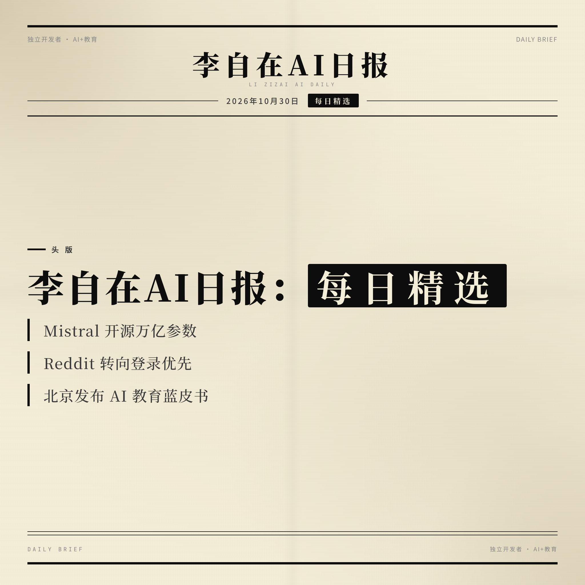
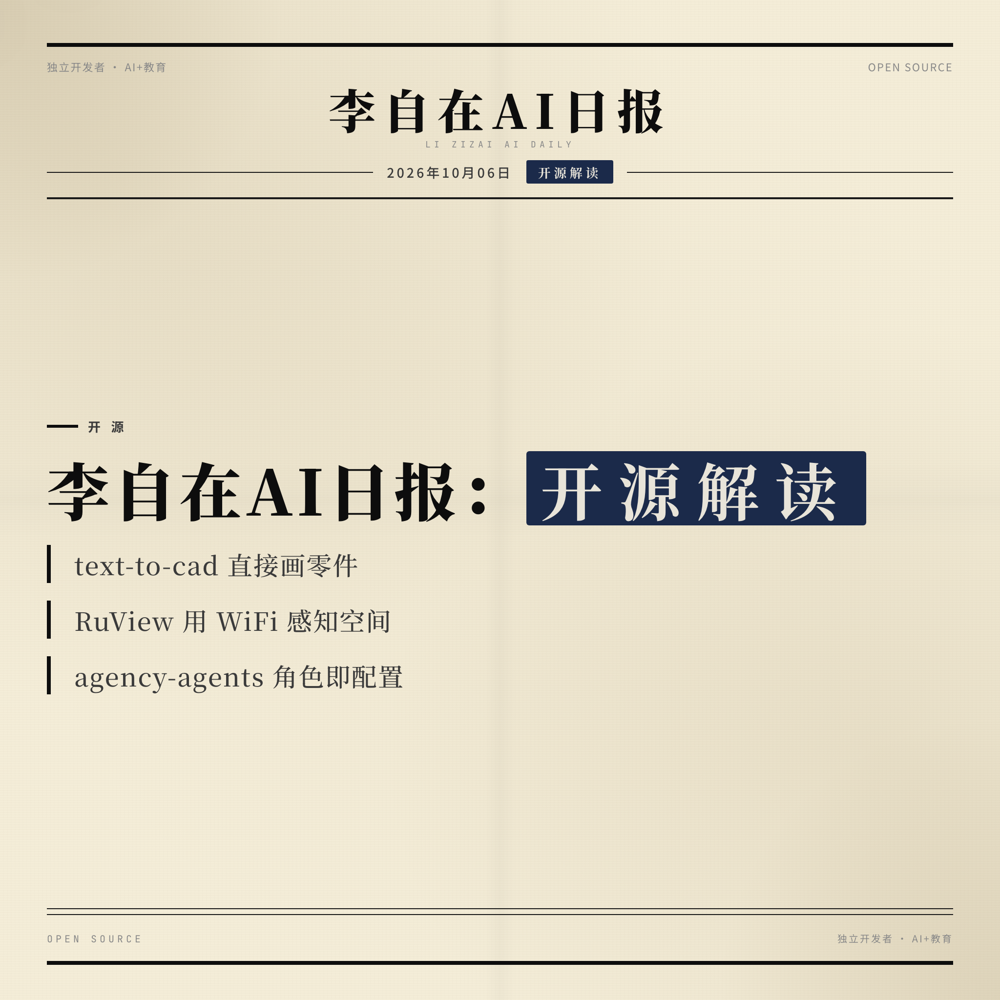
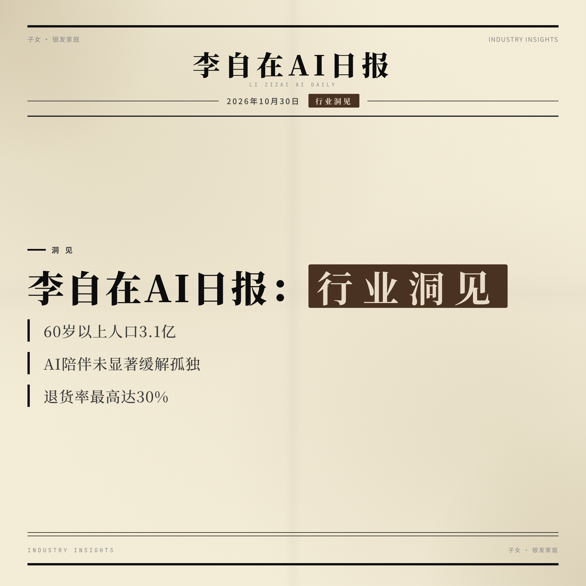

# lizizai-ai-daily-podcast

「李自在AI日报」全流程 AI 播客制作的完整 Skill 合集：从选题、调研、口播稿生成、口语化校验，到 TTS 配音、封面生成、成品校验、定时发布，一整套可以让 agent 独立跑通的生产流水线。

在线效果：[李自在AI日报 · 小宇宙](https://www.xiaoyuzhoufm.com/podcast/6a09a980f4ff26e89f601057)（全部单集均由本流水线生成）





## 内容矩阵

| 栏目 | 格式 | 时长 | 产出技能 |
| --- | --- | --- | --- |
| **每日精选** | 双人联播（李自在 + 肖然交替）+ 条目间翻页音效 | 8-12 分钟 | `ai-daily-podcast` |
| **开源解读** | 单人深度解读，5 个独立开发者可直接用的开源项目 | 8-10 分钟 | `ai-daily-podcast` |
| **行业洞见** | 单人深度分析，知乎大众 AI 热点 + 来源分级 + 理论支持 | 7-10 分钟 | `ai-daily-podcast` / `industry-insight-podcast` |
| **AI 人物志** | 访谈纪录片式 VO 旁白 + 人物真实原声 SOT | 8-20 分钟 | `lizz-biography-podcast` |
| **双人对话** | 角色化对谈（自定义音色/角色定位） | 4-8 分钟 | `duo-podcast-tts` |
| **一键转播客** | 火山引擎播客大模型端到端（文本/URL/主题） | - | `podcast-generation` |

## 工作流总览

```
┌─ 输入层 ──────────────────────────────────────────────┐
│  AI 日报 Markdown / 知乎热点 / B站原声 / 任意长文       │
└──────────────┬────────────────────────────────────────┘
               ▼
┌─ 选题与调研（Phase 0-1）──────────────────────────────┐
│  播客历史档案去重(7天) · 知乎热度五维评分 · DeepSeek    │
│  Search/Fetch 交叉核验 · 来源 A/B/C/D 分级             │
└──────────────┬────────────────────────────────────────┘
               ▼
┌─ 脚本生成（Phase 2）──────────────────────────────────┐
│  栏目模块文风 · 情感标签语法 · 品牌口播 · config.json  │
└──────────────┬────────────────────────────────────────┘
               ▼
┌─ 口播校验门禁（Phase 2.6）★ 本流水线核心独门 ★         │
│  de-AI 去味 · 数字单位转中文口播 · 人称/问句密度硬指标  │
│  TTS 禁区检查 · 未 PASS 禁止录音                       │
└──────────────┬────────────────────────────────────────┘
               ▼
┌─ 音频与封面（Phase 3）────────────────────────────────┐
│  火山引擎 Seed-TTS(情感标签) · 双人联播切人校验        │
│  翻页音效 · BGM 淡入淡出 · HTML 封面 Playwright 截图   │
└──────────────┬────────────────────────────────────────┘
               ▼
┌─ 交付与发布（Phase 4）────────────────────────────────┐
│  finalize 校验(config回填/尺寸/署名) · 小宇宙定时上传  │
└───────────────────────────────────────────────────────┘
```

## 仓库结构

```
lizizai-ai-daily-podcast/
├── config/                  # 双轨制 profile（默认=李自在品牌版，可换你自己的）
├── docs/
│   ├── workflow.md          # Phase 0-4 流水线详解
│   ├── lessons.md           # 口播校验硬指标 + ffmpeg 实测踩坑表
│   └── third-party.md       # 第三方技能安装指引
├── skills/
│   ├── ai-daily-podcast/            # 主流水线：日报三栏（选题→校验→TTS→封面→交付）
│   ├── industry-insight-podcast/    # 行业洞见独立单集（zhihu/dev 双模式 + 批量排期）
│   ├── lizz-biography-podcast/      # 人物志 VO/SOT 纪录片流水线
│   ├── duo-podcast-tts/             # 双人对话播客（阿里云 qwen3-tts / MiniMax）
│   ├── podcast-generation/          # 火山引擎播客大模型 WebSocket API 封装
│   ├── volcengine-tts/              # 火山引擎 Seed-TTS 底层封装（情感标签/流式/克隆）
│   ├── gemini-writer/               # Gemini API 长文生成（行业洞见大纲/逐字稿）
│   ├── xiaoyuzhou-upload/           # 小宇宙 Playwright 自动上传 + 定时发布
│   ├── biography-writer/            # 中文人物传记端到端生成
│   └── aliyun-tingwu-transcribe/    # 阿里云 ASR 词级时间戳转写（SOT 剪辑依据）
├── archive/                 # 旧版「大咖言论」行业洞见提示词存档
└── assets/
    ├── bgm/                 # 片头片尾 BGM（Kevin MacLeod, CC BY 4.0）
    ├── sfx/                 # 翻页音效
    └── demo/                # 成品封面示例
```

## 快速开始

### 1. 安装技能

把 `skills/` 下的目录复制/软链到你的 agent 技能目录（如 Claude Code 的 `~/.claude/skills/`），或整仓使用：

```bash
git clone https://github.com/lizizai-lzz/lizizai-ai-daily-podcast.git
# 整仓使用时，设置环境变量让脚本互相找到对方：
export PODCAST_SKILLS_ROOT=/path/to/lizizai-ai-daily-podcast
```

### 2. 配置 API 密钥（`~/.zshrc`）

| 变量 | 服务 | 用于 |
| --- | --- | --- |
| `VOLCENGINE_TTS_APPID` / `VOLCENGINE_TTS_ACCESS_TOKEN` | [火山引擎语音技术](https://console.volcengine.com/speech/service/10028) | 全部 TTS 配音 |
| `DOUBAO_API_KEY` / `DOUBAO_ENDPOINT_ID` | [火山方舟](https://console.volcengine.com/ark) | 播客大模型对话脚本模式 |
| `DASHSCOPE_API_KEY` | [阿里云百炼](https://bailian.console.aliyun.com/) | duo-podcast-tts / 听悟转写 |
| `GEMINI_API_KEY` | Google AI Studio | 行业洞见大纲与逐字稿 |
| `MINIMAX_CN_API_KEY`（可选） | MiniMax | duo-podcast-tts 备选引擎 |

### 3. 定制你的品牌（可选）

仓库默认值即「李自在」品牌版。想换成自己的节目：

```bash
cp config/profile.example.json config/profile.json
# 填入你的节目名、主持人、火山音色 ID、小宇宙节目 ID……
```

详见 [config/README.md](config/README.md)。

### 4. 跑第一期

对 agent 说：

> 读取 skills/industry-insight-podcast/SKILL.md，为今天生成一期行业洞见（zhihu 模式），生成后不上传，产物放在 ~/.daily-ai-news/data/{今天日期}/industry_podcast/

或从长文一键转播客：

> 用 skills/podcast-generation 把这篇文章转成双人对话播客：<文章或 URL>

## 第三方依赖

主流水线依赖 4 个未随库分发的第三方技能（qiaomu-ds-search、agent-reach、any-search、llm-wiki），安装指引见 [docs/third-party.md](docs/third-party.md)。缺失时流水线会按 SKILL.md 内的降级规则执行（如 de-AI 改写直接使用内联规则）。

## 文档

- [docs/workflow.md](docs/workflow.md) — Phase 0-4 全流程详解
- [docs/lessons.md](docs/lessons.md) — 80+ 期实际制作沉淀的硬指标与踩坑表
- [config/README.md](config/README.md) — 双轨制配置说明

## License

代码以 [MIT](LICENSE) 发布。多媒体资产有各自的授权约束，见 [NOTICE](NOTICE)。

## 免责声明

本仓库以「李自在AI日报」为默认品牌配置，那是作者真实的在更节目——直接使用默认 profile 会生成带有「李自在」品牌口播的内容，发布前请换成你自己的 [profile](config/README.md)。上传平台时请遵守平台规范：小宇宙要求勾选「本音频为 AI 生成」声明，该流程已内建在 `xiaoyuzhou-upload` 中。
